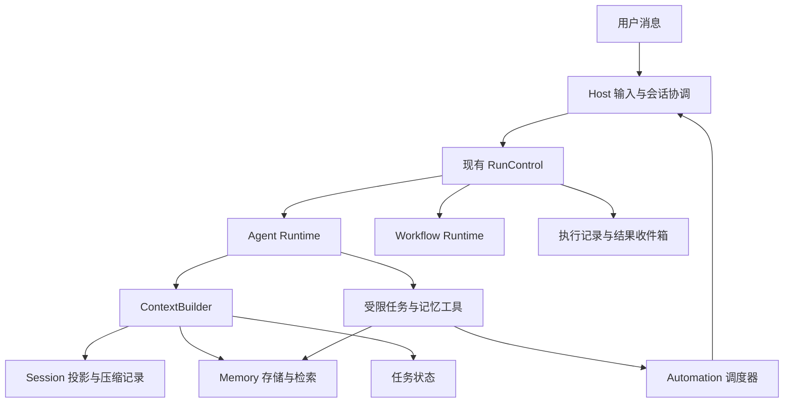

# AnomaloHaris 本地待命 Agent、自动任务与记忆方案

> 状态：Implementation Proposal，供其他 Agent 按阶段实施。产品形态已由用户确认；具体技术默认值是本文建议，不代表能力已经实现。
>
> 更新日期：2026-10-10

> 实施进度：第一版已接入，具体交付与提案的差异见第 20 节。后续增强仍是设计范围，不代表已经实现。
>
> 适用范围：个人实验、单机、单用户、现有 Node Host。
>
> 目标：Agent 随时接受消息，也能安排未来行动；长期使用后仍能延续工作、记住用户和项目。

> 阅读顺序：第 1–8 节解释架构；第 9 节定义已确认的 UI；第 13–19 节是实施契约、切片与验收。遇到旧讨论与本稿冲突，以本稿明确的第一版范围为准。

## 1. 建议采用的方案

在现有 Node Host 上增加持久化自动任务与记忆能力，继续通过 RunControl 执行 Agent 和 Workflow。Host 常驻，模型只在有消息、到期任务或需要整理记忆时运行。

整体采用以下组合：

- **统一调度**：用户定期任务、Agent 自行安排的一次性唤醒、记忆整理共用 Automation 模块。
- **独立执行**：后台任务有自己的 Session；主聊天接收重要结果，通过任务和共享记忆保持连续性。
- **上下文压缩**：参考 Pi，保留近期完整消息，把较早历史变成可追溯摘要。
- **跨会话记忆**：参考 nanoMuse，以 SQLite 保存可查看、修正和追溯的记忆条目。
- **后台整理**：参考 nanobot 的分阶段思路，对新增内容做有限整理，不持续调用模型反思。

第一版不引入 VPS、容器、分布式队列、独立向量数据库，也不更换 AgentCore。机器开机、保持唤醒、Host 运行并能访问模型时，才能执行后台任务；关机和睡眠期间只能在恢复后按规则补偿。

## 2. 当前代码基础与缺口

以下判断基于当前工作区，包含正在进行的运行时拆分；不是对某个发布版本的承诺。

| 位置 | 已有基础 | 需要补充 |
| --- | --- | --- |
| `apps/node-host/src/run-control.ts` | Run 持久化、幂等、事件、取消、并发限制、启动恢复 | 自动任务接入、后台生命周期、恢复策略协调 |
| `apps/node-host/src/agent-runtime-adapter.ts` | 指定 Preset Model 和 Session 执行 | 后台任务的调用上下文 |
| `apps/node-host/src/session.ts`、`sqlite.ts` | 会话日志、消息链、checkpoint；预留 compaction entry 类型 | 压缩记录契约、基于摘要的消息投影 |
| `apps/node-host/src/context.ts` | 汇总资源、历史和工具上下文 | token 预算、记忆选择、压缩后的上下文组装 |
| `apps/node-host/src/resources.ts` | 已有 memoryMessages 和文件资源加载 | 与新增可写记忆明确分工，避免重复注入 |
| `apps/node-host/src/plugins.ts` | 工具和部分生命周期 hook | 尚无 Pi 的压缩事件与完整扩展上下文 |
| `apps/node-host/src/host.ts` | 聊天和事件传输 | 当前聊天 WebSocket 断开会停止对应运行，后台任务需独立所有权 |
| `apps/node-host/src/main.ts` | 组装运行时、启动恢复 | 调度器生命周期和先保存状态再关存储的退出顺序 |

现有 `RunControl.recover()` 会重启符合条件的 queued Run；running/stopping Run 在重启后会失败，并非自动无缝续跑。现有 checkpoint 不等于任意崩溃点的恢复保证。

## 3. 领域概念与模块边界

| 概念 | 职责 |
| --- | --- |
| Preset Model | 定义一次 Agent 执行使用的模型、提示词、工具与策略 |
| Agent Profile | 持久的个人 Agent 身份，关联默认 Preset Model、主 Session 和记忆空间；第一版只有一个默认 Profile |
| Automation Task | 要执行的工作、时间规则、状态、输入、会话策略和预算 |
| Task Occurrence | 某次具体唤醒，例如某个日历时间的任务批次 |
| Run | 一次实际执行，身份、事件、取消和执行状态继续由 RunControl 管理 |
| Session | 一条对话及其上下文，不等同于 Agent 身份 |
| Memory | 跨 Session 保存的事实、偏好和决策 |
| Task State | 进度、上次检查结果、等待条件等执行状态，不依赖记忆摘要恢复 |

引入 Agent Profile 是为了让同一个个人 Agent 可以跨 Session、跨 Preset Model 版本保有记忆。它不应成为第三种 Runtime，也不必立刻提供多 Agent 管理 UI。



模块责任：

- **Automation**：任务定义、时间计算、到期领取、重叠与错过策略、发生批次到 Run 的关联。
- **RunControl**：运行身份、授权、事件、执行并发、取消和终态；不重复建设另一套执行管理器。
- **Session / Compaction**：原文、压缩边界、摘要记录、恢复时的上下文投影。
- **Memory**：条目、范围、来源、检索、版本与整理。
- **ContextBuilder**：按预算选择和组装输入，不拥有调度或记忆写入策略。
- **Host**：生命周期、API、前端订阅、结果呈现，以及操作系统常驻入口。

## 4. 待命与调度

### 4.1 唤醒来源

第一版支持用户消息、一次性时间、固定间隔和带时区的每日／每周规则，不开放任意 cron 表达式。Agent 自主安排后续工作时，默认创建一次性唤醒；每轮结束后再决定是否需要下一次。

固定心跳是可选的系统任务，默认关闭。没有待办时不需要定期调用模型。外部 webhook、文件变化等事件源延后实现，但使用同一个任务执行入口。

调度器在启动、恢复以及短周期检查时查询 SQLite 中的到期记录。内存定时器仅用于提高响应速度，数据库中的时间和状态才是依据。

### 4.2 第一版默认语义

| 情况 | 建议行为 |
| --- | --- |
| 一次性任务错过执行时间 | 默认恢复后执行一次；支持可选过期时间 |
| 周期任务错过多轮 | 合并补一次，记录错过次数，不连续补跑所有轮次 |
| 上一轮尚未结束 | 同任务串行，后续到期请求合并为一个待处理批次 |
| 用户与后台争用资源 | 用户请求优先排队；已开始的工具操作不强行抢占 |
| 相同 Session 被多个入口写入 | 统一协调，最多一个写入者 |
| 网络或限流失败 | 仅对可重试故障有限重试，退避并设置上限 |
| 需要用户批准或缺少信息 | Task 进入 waiting_user，保存问题；不空转重试 |
| 用户暂停任务 | 阻止未来唤醒；停止当前 Run 是单独操作 |
| 达到预算或连续失败上限 | 暂停自动推进，留下原因和通知 |

固定间隔与日历规则分别建模：前者以间隔锚点计算，后者保留 IANA 时区。建议日历规则遇到不存在的本地时间时跳过，重复时间只执行一次；使用成熟时间库验证夏令时边界。

### 4.3 持久化与幂等

建议增加 `automation_tasks` 和 `automation_occurrences`。Task 保存定义与当前状态；Occurrence 保存计划时间、输入快照、重试次数和 Run 关联。

每个批次有稳定 ID，例如由任务 ID、调度修订号和计划时间组成。将该 ID 作为 RunControl 的幂等键。任务定义修改后不能改变已经创建批次的输入。

领取批次、记录 dispatch 意图使用事务；提交 Run 后再关联 Run ID。如果进程在中间退出，启动时使用相同幂等键对账。需要固定该批次的目标 hash、权限、metadata 和输入，避免相同键重试时请求漂移。目标版本内容已改变且旧快照不可执行时，标记需要处理，不悄悄换配置执行。

这保证的是同一批次不会无意创建重复 Run，**不保证外部工具副作用 exactly-once**。例如邮件已发出但本地未记录结果时，不得自动重发。

### 4.4 Agent 可调用的任务能力

建议提供安排、列出、修改、取消唤醒的工具，以及更新任务进展的受限接口。工具调用只表达意图，Host 校验时间、目标、权限、数量和预算。

任务创建权限不包含扩大工具权限、取消预算或替用户授予新权限。每次唤醒重新检查当前权限；撤销权限立即影响未来执行。通知目标保存为明确关联，不能由任意提示词指定陌生收件人。

## 5. 会话与后台执行

主聊天用于与你交流。独立定期任务默认每个批次新建 Session；需要连续推进的同一个任务可以复用任务 Session，并使用同一压缩机制。

后台运行由 Host 持有，页面只是观察者。关闭页面不停止后台执行，重新打开后读取事件和状态。普通聊天断线策略可以保留现有行为，必须显式区分运行所有权。

后台检查的完整工具轨迹留在任务 Session。只有完成、重要变化、失败或需要用户输入时，写入结果收件箱；无变化检查只更新状态。主聊天可展示结果卡片，模型在后续交流中按需读取结果，不自动把全部后台日志追加到主上下文。

浏览器等依赖前端连接的能力需要标注可用条件。页面关闭后不可用的工具不能被视为后台可用；任务应进入等待或失败状态，而不是无限重试。

## 6. 上下文压缩

### 6.1 目标与数据

原始 Session 历史保留。模型读取的是投影：固定规则、任务状态、少量记忆、历史摘要及近期完整消息。

建议 Compaction Entry 包含摘要、被摘要的范围、首条保留消息 ID、原会话修订号、摘要模型与 usage、创建时间。它不覆盖或删除原文。

第一版采用“累计摘要 + 新增旧消息 → 新摘要”，保留近期消息。摘要记录目标、约束、关键决策、已完成与未完成工作、阻塞、产物引用和下一步。摘要属于有损上下文，不能成为权限或任务完成状态的唯一依据。

### 6.2 触发与预算

预算覆盖实际模型输入：系统提示、工具 schema、资源、记忆、任务状态、历史、图像估算和输出预留。每次模型调用前检查，而不只在用户消息到来时检查，避免单次长工具循环撑满上下文。

优先采用 Provider 可用的 usage，再估算新追加内容；模型窗口由配置或模型元数据提供。阈值和近期保留量随模型调整，不统一硬编码为某个 token 数。

处理顺序建议：

1. 大工具结果另存产物，模型输入使用有大小限制的片段和读取引用。
2. 历史接近预算时压缩较早部分。
3. 固定规则、工具定义或单条输入本身过大时，明确报错或提示调整；压缩历史无法解决此类问题。
4. Provider 明确返回上下文超限时，至多尝试一次针对性压缩恢复，禁止无限循环。

### 6.3 一致性与恢复

- 在工具调用结果已经配对的安全边界压缩，不能留下孤立 tool result。
- 摘要生成时固定待压缩范围；提交时校验 Session 修订，不能覆盖同时到来的消息。
- 只有摘要成功保存后才切换上下文投影；空摘要、取消和失败均保留旧记录。
- checkpoint 必须记录其对应的压缩投影或修订。恢复时不能把旧 loopMessages 与新投影重复拼接。
- 第一版可串行执行同 Session 的压缩；前端显示短暂整理状态。

### 6.4 Pi 复用边界

Pi 的压缩是宿主能力，扩展通过 `session_before_compact` 定制摘要。当前项目尚未实现此接口，不能直接安装扩展就获得完整能力。

先参考并适配其切分、摘要和重建流程；是否直接依赖上游模块，在编码前检查具体版本、导出 API、消息类型与依赖。完整 Pi 压缩扩展兼容放在后续，避免第一版同时承担整个 Session API 兼容。

## 7. 长期记忆

### 7.1 范围和存储

SQLite 是新增可写记忆的唯一权威存储；正文可以是 Markdown。提供界面查看编辑和 Markdown 导出，不同时维护两份可写权威数据。

| 范围 | 内容 | 注入方式 |
| --- | --- | --- |
| 用户 | 已确认的偏好、习惯与长期约束 | 精选少量常驻，其余检索 |
| Agent | 该身份积累的通用经验 | 按需 |
| 项目 | 项目约定、架构决策、环境事实 | 当前项目范围内检索 |
| 任务 | 临时检查信息与进度 | 使用结构化 Task State，不升级为长期记忆 |

现有文件资源仍负责人工维护的静态上下文。新增记忆不自动修改这些文件；组装时区分来源并避免重复。记忆范围绑定 Profile 和项目，不能仅绑定可编辑的 Preset Model 版本。

### 7.2 记忆条目

建议条目包含：ID、正文、类别、范围、来源类型、来源 Session/Run/Entry 引用、创建与更新时间、可选有效期、状态、被哪条记忆替代，以及写入模型信息。

来源类型区分用户明确陈述、用户明确要求记住、Agent 根据执行证据总结、未确认推断。模型自报的置信度不能代替证据；推断不得被自动提升为用户规则。

记忆引用权限上下文时只记录事实，不赋予执行权限。外部内容作为证据保存，不能提升为系统指令。

### 7.3 写入、读取、修正

**写入**：用户明确要求记住时立即保存；本轮确认的长期决策可由 Agent 调用记忆工具保存；普通日志不逐条自动转成长期记忆。临时约束保留范围和有效期。

**读取**：运行开始按当前消息、项目和任务检索，固定本轮注入快照；第一版使用关键词与中文友好的分词/双字检索，配合近期性和范围过滤。评估召回效果后再加 embedding。条目数量上限不能替代 token 预算。

**修正**：新事实替代旧事实时保留关系；历史条目默认不进入当前上下文。并发更新使用版本检查，防止后台整理覆盖用户刚改过的记忆。

**遗忘**：区分“停止使用”和“彻底删除”。用户要求彻底忘记时，需要同步清理检索索引、派生摘要和可恢复副本的相关内容；若源会话仍保留，应记录禁止再次提取的范围，避免整理后重新学回来。界面明确实际处理范围。

### 7.4 后台整理

第三阶段增加系统拥有的 Memory Maintenance Task，复用 Automation。记录已处理历史游标，只读新增内容，有新内容且达到条件才调用模型。

模型提出新增、合并、替代或过期建议，由 Memory 模块检查 ID、范围、版本、来源和单批修改上限后提交。用户明确写入的条目不由整理器自动删除；冲突保留证据并等待确认。

每批变更记录前后版本和理由，可查看、撤销。后台整理失败不阻止普通聊天，也不标记尚未成功提交的内容为已处理。它不应在整理过程中再安排自己的无限整理任务。

## 8. 运行可靠性与预算

单机第一版要求一个调度 Host 对同一任务数据库持有所有权。若误启动第二个 Host，应拒绝成为调度写入者；无需引入分布式租约系统。

启动顺序：打开存储并读取 Bot 开关 → 注册 Runtime 和恢复准入检查 → RunControl 恢复 → 对账发生批次 → 仅对启用的 Bot 恢复调度 → 接受输入。不能先恢复所有 Bot queued Run，再读取停用配置。

退出顺序：停止接收和领取新任务 → 对活动执行发出有界停止请求 → 等待 checkpoint/终态写入 → 关闭传输和存储。强制崩溃仍按中断恢复规则处理，不承诺恢复到任意工具内部位置。

第一版限制：每次 Run 时长、工具轮次、后台并发、每日后台 token 配额、连续失败次数、待调度任务数量。记忆整理和摘要模型消耗也纳入统计。使用量未知时明确标记，不能当作零消耗。配额在模型请求开始前和结束后检查；已经发出的请求可能造成超额，因此不宣称精确费用硬上限。

Host 可由本机服务管理器开机启动和退出重启；这属于部署步骤，不在本次设计评审阶段安装系统服务。

## 9. 最小产品界面

用户已确认以下产品形态：

- 在现有标题导航区增加 **Bot**，建议放在 Agent 后、Buddy 前；保留现有入口。
- 点击直接进入唯一 Bot 的主聊天，不增加 Bot 列表、创建向导或多 Agent 工作台。
- Bot 页提供设置入口，以 **radio：启用 / 停用** 控制 Bot 是否运行；默认停用。
- 页面切换与启停独立。进入 Bot 页不会启用，离开页面不会停用。
- 停用后，Bot 聊天只读，任务不执行；普通 Agent 页保持可用。
- 从启用切到停用时，拒绝新运行、停止领取任务，并请求已有 Bot Run 在可停止边界结束。界面在收尾完成前显示“正在停用”。

第一版页面以聊天为主体，页内提供“任务”“记忆”“设置”面板入口，不增加顶层 Feed、Ideas 或 Library 导航。重要后台结果作为独立结果卡片呈现，可跳到任务详情。

任务面板展示目标、下次执行时间、上次结果、立即执行、暂停与取消。记忆面板提供查看、编辑、来源与停止使用。上下文占用与手动压缩放在详情中，避免占用主界面。

第一版通知仅在应用内呈现；系统通知或外部渠道后续增加。停用不会删除任务与记忆，也不会撤销已发生的外部操作。关闭整个 Node Host 后无法继续运行；设置里的“启用”不等于操作系统开机启动。

## 10. 实施阶段与验收

### 阶段一：后台执行与持久化调度

实现 Task/Occurrence、到期恢复、稳定幂等、后台 Run 所有权和最小结果页。支持用户创建任务及 Agent 安排一次性唤醒。

验收：关页面后继续；重启不丢待执行任务；错过多轮仅补一次；同任务不重叠；相同发生批次不重复创建 Run；暂停不再产生未来执行。

### 阶段二：上下文压缩与基础记忆

实现 Session 投影、预算检查、摘要持久化、checkpoint 协调；增加记忆读写、来源与版本、基本检索和用户编辑。

验收：长会话压缩后能继续；工具调用配对完整；压缩失败保留原文；恢复不重复消息；新 Session 能召回明确保存的偏好；项目范围不串用；用户更正后旧记忆不继续作为有效事实出现。

此阶段完成前，阶段一只适合短任务试验，不应宣称具备稳定长期记忆。

### 阶段三：后台整理与常驻体验

增加增量记忆整理、错误退避、预算展示、运行收尾和本机服务部署说明。根据真实使用结果决定 embedding、可选心跳与外部事件接入。

验收：无新增内容不调用整理模型；失败不推进游标；用户编辑不被旧后台快照覆盖；遗忘内容不会再次自动提取；正常退出先保存状态再关闭数据库。

### 测试约束

遵循项目约定：后端先写单元测试再实现；使用虚拟时钟、临时 SQLite 和脚本模型测试调度、崩溃窗口、压缩与记忆修订。前端不新增单元测试；需要自动化验证时使用 Playwright 脚本，不用 Computer Use 模拟点击。完整系统测试安排在集成收尾阶段。

重点故障场景包括：提交 Run 前后分别崩溃、目标 hash 改变、睡眠跨多个周期、夏令时重复时间、停止与领取竞争、摘要期间新消息到达、工具已产生效果但结果未落盘。

## 11. 已确认选择与实施默认值

单个 Bot 页面、radio 启停、轻量本地实验和复用现有运行时已确认。其余采用下列实施默认值；实施者遇到代码约束时应记录偏差，不自行扩展为平台工程。

| 问题 | 建议 | 取舍 |
| --- | --- | --- |
| 一个身份还是多个常驻 Agent？ | 已确认：一个 Bot，内部固定 Profile ID | 降低 UI 与权限复杂度 |
| 后台任务是否共用主会话？ | 默认独立 Session，结果回主聊天 | 上下文更干净；需明确传入任务背景 |
| 第一版是否开放模型主动保存记忆？ | 开放，但记录来源和范围；推断与确认事实分开 | 更自然，同时需要查看与修正入口 |
| 记忆主要保存在文件还是 SQLite？ | SQLite 权威存储，提供 Markdown 导出 | 与项目现有持久化一致，文件直接编辑不作为第一版入口 |
| 是否需要无任务也定时检查的心跳？ | 默认关闭 | 减少无效模型调用；可后续开启 |
| 先移植 Pi 还是完整支持 Pi 插件？ | 先适配压缩核心流程 | 更快验证；暂不承诺扩展即插即用 |
| 是否首版引入 embedding？ | 暂不引入，先测关键词召回 | 少一个模型依赖；语义改写召回较弱 |
| 任务是否随 Preset Model 编辑自动更新？ | 下一批次用当前定义，已创建批次固定快照 | 行为可更新，同时保持单次执行可追溯 |

## 12. 参考与适用边界

外部实现查阅日期为 2026-10-09，链接指向可变化的主分支或文档。实际移植代码前需固定版本并核对依赖与许可证。

- [Pi Compaction](https://github.com/badlogic/pi-mono/blob/main/packages/coding-agent/docs/compaction.md)：宿主负责压缩边界、记录和重建，扩展可定制摘要。
- [nanoMuse Python Agent](https://github.com/nano-muse/nanoMuse/blob/main/nanomuse/agent/core.py)：消息窗口、图片保留、运行前记忆召回。
- [nanoMuse MemoryStore](https://github.com/nano-muse/nanoMuse/blob/main/nanomuse/memory/store.py)：SQLite 条目、中文双字检索、可选语义索引与变更记录。
- [nanoMuse Consolidation](https://github.com/nano-muse/nanoMuse/blob/main/nanomuse/memory/consolidate.py)：模型提议、程序校验、整理预算和用户记忆保护；词汇检查不能保证语义正确。
- [nanoMuse Desktop](https://github.com/nano-muse/nanoMuse/blob/main/docs/desktop.md)：新桌面版基于 DeepSeek Harness，不能与 Python/Android 实现混为一套。
- [nanobot Memory](https://github.com/HKUDS/nanobot/blob/main/docs/memory.md)：历史整理与长期记忆维护分阶段执行。
- [OpenClaw Heartbeat](https://docs.openclaw.ai/gateway/heartbeat)：心跳作为自动任务、可选择独立上下文。
- [Letta Memory](https://docs.letta.com/configuration/memory)：可查看的跨会话记忆与后台整理。

本文推荐的是适合 AnomaloHaris 的组合，不是复制任一项目的完整运行时，也不依赖这些项目的云服务或部署形式。

## 13. 第一版执行契约

### 13.1 必须实现与延后内容

| 第一版必须完成 | 延后，不作为第一版依赖 |
| --- | --- |
| 顶部 Bot 页、唯一主会话、radio 启停 | 多 Bot、多用户、多设备同步 |
| Bot 聊天脱离页面保持运行、刷新后恢复显示 | 全局重写普通聊天 transport |
| 单次、间隔、每日／每周任务，Agent 安排唤醒 | 任意 cron、webhook、文件监听、无任务心跳 |
| 任务状态、执行历史、结果卡片 | 单独 Feed、Ideas、Library 产品 |
| 摘要加近期消息、手动与自动压缩 | 完整 Pi Session／扩展兼容 |
| 显式记忆读写、来源、修正、基础检索 | embedding、知识图谱、自动反思 |
| 重启对账、停止传播、预算与故障提示 | 分布式执行、透明恢复任意工具调用 |

后台记忆整理属于后续增强，不能阻塞第一版。底层目标类型沿用 `preset_model | workflow`，但第一版 Bot UI 与 Agent 调度工具只创建 Preset Model 任务；Workflow 自动化入口后续开放，现有 Workflow 功能继续独立工作。

### 13.2 启停状态

持久化 `enabled` 表示用户期望；`runtime_state` 是 Host 根据实际运行计算的只读状态，不能由前端直接提交。

| runtime_state | 条件与页面表现 |
| --- | --- |
| `disabled` | enabled=false，且没有待收尾 Bot Run；历史可读，输入禁用 |
| `starting` | enabled=true，正在校验配置／对账；输入暂不可用 |
| `idle` | enabled=true、配置可用，没有活动 Bot Run；显示“待命” |
| `working` | 有 Bot Run 执行；显示当前任务和停止按钮 |
| `stopping` | enabled=false，但仍有活动或正在取消的 Bot Run；显示“正在停用” |
| `degraded` | enabled=true，但目标不可用、存储或恢复故障等阻止执行；显示具体原因 |

Host 无响应由前端显示“连接中断”，不要把 radio 改成停用。某个任务 waiting_user 不代表整个 Bot 故障，在状态旁显示待处理数量即可。

启用流程：校验 Preset Model 和配置 → 持久化 enabled=true、递增 revision → 对账并开放准入。重复启用是幂等的，不创建第二个主 Session 或重复调度器。

停用流程：在串行准入区先提交 enabled=false → 取消尚未提交的用户请求 → 停止所有属于 Bot 的 queued/running Run（含其子 Run）→ 停止后台整理 → 等待收尾后进入 disabled。一个不响应取消的工具会使状态保持 stopping 并显示超时原因，不能假称已经停止。

开启/关闭接口不等待所有工具退出才响应；返回当前期望状态与实际状态。stopping 期间暂不接受重新启用，返回可解释的冲突错误；刷新后可继续观察。

停止当前 Run 只影响本次执行；停用 Bot 影响整个 Bot；暂停任务只影响指定任务的未来执行。三个动作分别呈现和记录。

### 13.3 所有权与准入

内部固定 `bot_id=default`，首个主 Session ID 由后端创建并持久化。Bot 的用户输入、定期任务、整理任务均带可信执行所有权：

```ts
type BotRunOrigin = {
  botId: "default";
  source: "user" | "schedule" | "maintenance";
  taskId?: string;
  occurrenceId?: string;
  configRevision: number;
};
```

该来源由 Host 写入 Run 的受保护记录；客户端不能通过随意传入 metadata 冒充 Bot。RunControl 增加通用准入回调或等价内部接口，在启动、实际领取执行槽位和恢复 queued Run 时检查，不能只在 HTTP 路由检查一次。

Session 标记 owner。普通 `/api/chat`、WebSocket、Session 删除／修改入口也必须识别 Bot 所有权，拒绝绕过 BotService 修改其 Session。检查复用一个 helper，不把规则散落在每个路由。

第一版 Bot 总运行并发为 1，用户输入优先于后台任务。后台任务忙时可接受一个待处理用户请求；同一请求 ID 重试返回原记录，第二个不同请求返回 `bot_input_pending`。该 pending 请求持久化，但不提前追加到模型历史；开始执行时只追加一次。无需实现复杂聊天抢占或运行中消息注入。

启用状态重启后恢复；用户主动停用会取消 pending 用户请求，重新启用不能悄悄发送此前未开始的消息。已在执行的消息按中断状态显示，由用户决定是否继续。

### 13.4 Preset Model 切换

默认选择实例的默认已发布 Preset Model，必须校验引用可执行。Bot 工具必须通过现有工具授权和 Preset Model 编译路径显式绑定，不能借“内置工具”绕过 catalog/allowlist。

不要在后台修改用户已有 Preset Model。如果默认模型没有 Bot 工具，设置页说明缺失能力并链接 Preset Models 配置；基本聊天可以运行，涉及缺失能力的任务返回明确错误。

已有主 Session 不允许无提示换绑模型。用户在设置切换默认引用时，要求 Bot 已停用且旧 Session 无未处理 checkpoint；创建一个新主 Session，旧主 Session 保留为只读历史，记忆继续共享。任务保存创建时的明确目标引用，不跟随 Bot 默认引用隐式变更。

同一引用的定义内容被编辑：新发生批次解析当前 hash；已有发生批次保留原 hash。无法执行原 hash 时进入 waiting_user，说明目标已改变，由用户重试生成新批次。

## 14. 数据模型与事务

### 14.1 存储选择

第一版通过现有 RunControl 所用 SQLite 连接增加 Bot 表，让任务发生批次、请求幂等和 Run 关联可在同一数据库对账。不单独引入 `bot.sqlite`。数据库的创建和关闭由 composition root 统一管理，不能让 BotStore 自行关闭共享连接。

Session 数据若仍在独立连接／数据库，不宣称跨库事务：使用预生成的稳定 Session ID、幂等 ensureSession 和可恢复的两步初始化。初始化中断后继续同一个 ID，不创建孤儿主会话。

### 14.2 最小表结构

下表是逻辑 schema，实际 SQL 通过版本化、增量迁移创建；JSON 仅用于可扩展对象，关键状态和索引字段使用列。

| 表 | 必要字段与约束 |
| --- | --- |
| `bot_profiles` | `id`（仅 default）、enabled、revision、preset_model_ref、main_session_id、timezone、limits_json、created_at、updated_at |
| `bot_requests` | request_id、bot_id、session_id、message、status（pending/dispatched/cancelled/failed）、run_id、request_hash、created_at；唯一 `(bot_id, request_id)` |
| `automation_tasks` | id、bot_id、title、prompt、target_kind/ref、schedule_json、schedule_revision、revision、status、next_due_at、session_policy、task_session_id、state_json、consecutive_failures、created_by、created_at、updated_at |
| `automation_occurrences` | id、task_id、schedule_revision、scheduled_at、status、dispatch_key、request_snapshot_json、run_id、retry_count、next_retry_at、missed_count、error_json、created_at；唯一计划批次键 |
| `bot_results` | id、bot_id、task_id、run_id、kind、summary、artifact_refs_json、read_at、created_at；唯一 `(run_id, kind)` 防止终态对账重复通知 |
| `bot_memories` | id、bot_id、scope、scope_id、category、content、status、revision、source_json、supersedes_id、expires_at、created_at、updated_at |
| `bot_memory_changes` | id、memory_id、before_json、after_json、actor、reason、source_run_id、created_at |
| `bot_memory_exclusions` | id、bot_id、source_range_json、created_at；停止使用后防止同一来源被再次整理提取 |

`source_json` 包括来源类型、Session/Run/Entry 引用及可用的模型信息。scope_id 采用稳定项目身份；第一版可用规范化的 Host workspace ID，不根据提示词任意创建项目范围。

Task 状态为 `active | paused | waiting_user | completed | cancelled`。运行中与否通过当前 Occurrence/Run 推导，不同时设置 task.status=running，避免两个状态字段互相漂移。

Occurrence 状态为 `pending | dispatching | linked | succeeded | failed | stopped | skipped`。`linked` 表示已关联 Run，其实际执行状态从 RunControl 读取；终态为任务审计快照，可启动时重建。禁止在两个系统分别执行取消和重试状态机。

时间点统一保存 UTC ISO 字符串；日历时区另存 IANA 名称。分页按时间和稳定 ID 排序。为 status/next_due_at、task_id/created_at、bot_id/scope/status 建索引。

### 14.3 Schedule 契约

```ts
type BotSchedule =
  | { type: "once"; at: string; expiresAt?: string }
  | { type: "interval"; everySeconds: number; anchorAt: string }
  | { type: "calendar"; localTime: string; timezone: string;
      weekdays?: number[] }; // ISO 1=周一，7=周日；省略表示每天
```

localTime 为 HH:mm。自然语言由 Agent 转成结构化时间，后端验证；工具结果返回明确的本地时间和时区。每周规则 weekdays 不得为空；间隔最短 60 秒；一次性时间已到但未过期可立即领取。

建议默认：调度检查 5 秒，最多 100 个 active 任务，单次运行 10 分钟，连续 3 次失败后暂停任务。沿用模型现有更严格的轮次限制。每日后台 token 配额默认 200,000，按 Bot 时区自然日统计；数值可设置，不作为产品承诺。

定期任务完成一轮不把 Task 标成 completed；仅一次性任务成功或显式完成才进入 completed。一次性任务需要继续跟进时，工具更新同一个任务的下一次唤醒，不无限创建新任务。执行中的周期任务修改规则，只影响尚未创建的发生批次。

### 14.4 Dispatch 与重试算法

1. 获取本机 Host 单实例所有权；建议在数据目录使用成熟的进程锁实现，不仅依赖 Web 端口，退出释放，崩溃残留按 PID 存活规则处理。
2. 在 Bot 准入串行区检查 enabled、配额和待处理用户请求。
3. 事务内创建到期 Occurrence、推进 next_due_at；唯一约束解决重复 tick。
4. 固定输入、目标 hash、会话 ID 和允许权限上界，记录 dispatching；事务完成后调用 RunControl。
5. 使用 `bot:<botId>:occurrence:<id>:attempt:<n>` 作为幂等键；保存 Run ID 并进入 linked。
6. Run 终态后更新发生批次、任务状态与结果卡片；写入幂等，可在重启时重复对账。

现有 RunControl 会将目标 hash 纳入请求 hash。恢复 dispatching 时先按稳定幂等身份查找已有 Run，找到后直接校验并关联；只有确认尚未创建，才检查当前目标 hash 并调用 start。不能每次都重新 resolve 后盲目 start，从而把已创建的旧批次误判为幂等冲突。

可重试失败产生新 attempt ID 和新 Run，原批次身份不变；原 Run 已失败时不能用同一键期待重新执行。建议最多自动重试 2 次、等待 30 秒和 120 秒；仅限明确没有外部副作用的故障，无法判断时 waiting_user。网络错误发生在工具中途不等于整个任务可以安全重跑。

检查点继续也必须明确执行身份：若 RunControl 为继续操作创建新 Run，则当前工具上下文、事件、用量、任务进度和新 checkpoint 都归属新 Run ID；旧 Run ID 只作为恢复来源保存。不能让外层 RunControl 使用新 ID、内层 Agent 继续使用旧 ID。连续两次中断和继续必须仍能正确关联进度与 checkpoint。

调度准入应在最后一个异步准备步骤之后重新检查任务状态和 revision，并与暂停／取消操作串行化。尚未提交的批次若已被取消，不得继续 start；错误收尾也不得用旧任务快照覆盖用户刚提交的修改。列表分页与内部调度查询分开：调度和恢复必须覆盖全部非终态记录，不能只遍历 UI 最近若干条历史。

停用时，pending 发生批次保留；已经创建的 queued Run 显式停止。重新启用时，仍未执行的批次可以产生新的 attempt；中断的 running Run 默认 waiting_user。不能因为开启开关就自动重放可能产生副作用的工具。

## 15. API、工具与传输

### 15.1 HTTP 路由

新增 `registerBotRoutes()`，挂载 `/api/bot`；现有 `/api/memory` 文件接口继续保留，不混用为 Bot Memory API。所有输入使用 contracts 中的运行时 schema 校验。

| 方法与路径 | 行为 |
| --- | --- |
| `GET /api/bot` | 配置、revision、runtime_state、当前 Run、主 Session、待处理数量和配额 |
| `PATCH /api/bot/settings` | `{expected_revision, enabled?, preset_model_ref?, timezone?, limits?}`；只修改明确字段 |
| `GET /api/bot/session` | 主会话消息／运行分组分页、当前 Run 和 checkpoint 概况 |
| `POST /api/bot/messages` | `{request_id, message}`；202 返回 request_id、session_id、run_id（可为空）、状态 |
| `GET /api/bot/requests/:id` | 查询排队消息是否开始以及对应 Run |
| `GET /api/bot/runs/:id/events?after_sequence=N&limit=200` | 立即返回已持久化事件快照、next_sequence、has_more 和 Run 状态 |
| `POST /api/bot/runs/:id/stop` | 幂等停止当前 Bot Run，不停用 Bot |
| `POST /api/bot/session/resume` | 用户明确继续 checkpoint；要求 Bot 启用且主会话空闲 |
| `GET/POST /api/bot/tasks` | 分页查询／创建任务 |
| `PATCH /api/bot/tasks/:id` | 带 expected_revision 修改规则、正文、状态；不修改已 dispatch 批次 |
| `POST /api/bot/tasks/:id/run` | 创建手动 Occurrence；必须携带 request_id，不推进原周期时间 |
| `GET /api/bot/tasks/:id/runs` | 列出发生批次、关联 Run 与错误 |
| `GET /api/bot/results` | 结果卡片分页，支持未读过滤 |
| `POST /api/bot/results/:id/read` | 幂等标记已读，不调用模型 |
| `GET/POST /api/bot/memories` | 范围过滤查询／人工添加 |
| `PATCH /api/bot/memories/:id` | 带 expected_revision 更新或停止使用 |
| `GET /api/bot/memories/:id/history` | 查看来源和修订历史 |
| `POST /api/bot/session/compact` | 对空闲、无未处理 checkpoint 的主会话执行手动压缩 |

创建与执行接口必须有请求幂等，PATCH 使用乐观并发。Bot 消息 request_id 相同且正文不同返回冲突，不再追加消息。网络超时后前端重试同一 request_id。

错误统一使用现有 `{error, error_code}` envelope；建议区分 `bot_disabled`、`bot_stopping`、`bot_input_pending`、`bot_revision_conflict`、`bot_target_changed`、`bot_budget_exhausted`、`bot_capability_unavailable`、`bot_resume_required`。不存在和不属于该 Bot 的 Run 不返回其内容。

复用现有管理访问校验和 `managementAccess.js`，不要发明第二种 token。启停、配置、任务和记忆修改均属于管理操作。单机无 token 模式遵循现有 Host 本地策略，不另开匿名远程入口。所有 Bot 读取接口也执行所属范围检查，分页不能泄露其他会话。

### 15.2 第一版使用短轮询

为了降低实现量，Bot 页不新增 WebSocket 协议。执行提交后立即返回，通过持久化事件短轮询显示增量输出：活跃 Run 每秒轮询；空闲状态每 5 秒读取；页面隐藏时降低频率或暂停，返回前台立即刷新。

直接使用 `RunControl.eventsSnapshot()` 的有界版本，**不能在请求中消费 `events()` 直到 Run 结束再返回**。现有 API 对不同 Runtime 的投影不同，Bot 路由统一返回带 sequence 的 `ExecutionRunEvent`，客户端适配器将其中的 Agent 事件转交既有投影逻辑。

前端用 `(run_id, sequence)` 去重，has_more=true 时继续拉取，网络重连携带已处理游标。历史加载需返回对应水位，保证“加载历史 + 拉取事件”不会重复渲染；若暂时无法提供可靠快照水位，按 Run 分组重建当前活动组而不是拼接两份消息。

页面组件卸载只 abort 前端 fetch 和清理定时器，绝不调用 stop。前端持久化视图偏好即可，Bot enabled、主 Session 和任务状态都以后端为准。

### 15.3 工具契约

第一版提供少量工具，参数使用已有工具 Schema 机制，Host 从调用上下文注入 bot_id、scope 和来源，模型不能伪造这些字段。

| 工具 | 主要输入 | 返回 |
| --- | --- | --- |
| `bot_schedule` | 标题、任务指令、结构化 schedule；可选更新已有 task_id | 任务 ID、明确下次时间、时区 |
| `bot_tasks` | 查询状态；更新时显式 task_id 和 revision | 任务状态和最近结果 |
| `bot_task_update` | 当前任务的进度、next_action、等待问题、完成标志 | 已保存状态；不自行触发工具重试 |
| `bot_memory_search` | query、当前允许范围 | 有限条目、ID、来源引用 |
| `bot_memory_write` | content、category、可选替代 ID/revision | 已保存条目和修订 |
| `bot_memory_deactivate` | ID、原因 | 停止召回，不声称彻底删除原始历史 |

`bot_schedule` 默认继承当前 Bot 允许的目标引用，不接受任意模型、插件、权限或通知收件人。任务工具返回结构化存储结果后，Agent 才能宣称安排成功。

阶段一没有通用持久审批系统时，不新造完整审批引擎：需要确认的工具返回结构化“需用户处理”，Task 进入 waiting_user 并保存具体问题；用户答复后显式恢复或新建一次执行。不得把一个内存中的 approval Promise 当作可重启恢复能力。

## 16. 上下文与记忆实施补充

### 16.1 一个上下文准备入口

在 Agent Runtime 的模型请求边界增加 `prepareModelContext` 或同等深模块，复用现有 ContextBuilder。它接收已校验的运行快照和 Session 投影，输出最终模型输入与预算诊断。

当前 `AgentRun.buildContext()` 之后还可能有 context hook 修改消息和工具，因此预算校验必须覆盖 hook 后的最终输入。不能在 hook 前判定安全，之后允许插件无限增大上下文。必要时重新投影一次；不能因 hook 不断增加消息而无限反复压缩。

压缩模块通过现有 ModelAdapter 调用摘要模型，不引入第二套 Provider 密钥解析。摘要调用无业务工具，只生成结构化交接摘要，并计入所属 Run 用量。失败、取消、摘要仍然过大时返回明确结果。

所有模型调用共用预算准入与记账，包括手动压缩、自动压缩、分批摘要和最终收尾。每批调用前检查剩余额度，每批成功返回 usage 后立即记账；后续批次失败不能抹去已经发生的消耗。额度耗尽后手动压缩也不得绕过限制。没有 usage 时记录未知状态和保守估算；模型选择必须来自当前已解析的 Preset Model，不能混用全局默认模型名与另一个 Provider 配置。

### 16.2 Session 投影最小扩展

SessionRepository 增加：读取带 Entry ID 的当前分支、读取当前投影修订、以 expected_revision 原子追加 Compaction Entry。内存和 SQLite Adapter 必须提供同一语义。

`SessionSnapshot.messages` 定义为模型所需投影；UI 原始历史使用独立分页读取接口，避免压缩后聊天记录从页面消失。持久化 checkpoint 包含 `projection_revision` 和 loop 消息对应 Entry ID／已落盘位置。

长 Run 内压缩前，需要先将已经完成配对的当前工具轮次写入 journal，再按 Entry ID 投影并清除已写入的 loop 后缀。禁止仅根据文本相等猜测重复消息；如现有实现仍依赖文本去重，应在这个切片中补上稳定身份。

默认保留最新用户请求与最近完整工具轮次。一个用户跨度本身过大时，可摘要更早且已完成的工具轮次，但必须保留原始任务约束和当前待完成动作；任何尚未有结果的 tool call 不进入压缩范围。

分批摘要必须覆盖待压缩的完整用户消息和助手消息，超长单条消息按片段继续处理，不能先截取前几千字符再把整条标记为已摘要。工具输出允许裁剪，但必须显式保留原文 Entry 引用和读取能力；日志仍在磁盘上不等于被遗漏的任务约束仍在模型上下文中。

### 16.3 记忆的最小完整实现

第一版只自动注入少量核心记忆和当前项目相关记忆，固定每轮快照；其余通过 search 工具读取。Bot 主会话与后台会话共享 Bot Memory，普通 Agent 页默认不读取或写入这份记忆，防止实验污染现有聊天。

明确保存与替代使用同一事务写正文、修订和来源。工具只能标识“Agent 保存”；若要标识“用户确认”，必须引用真实用户 Entry，由 Host 验证来源，不能让模型自行传 `source=user`。

第一版界面提供“停止使用”，保留审计与恢复能力，并明确这不等于擦除聊天原文。完整删除与派生记录清理属于独立后续切片；未完成之前不要提供名为“彻底忘记”的按钮或承诺。第 7 节的遗忘要求是该后续能力的完成条件。

压缩摘要不能重新包含已被用户撤销的长期记忆并将其当作当前事实；ContextBuilder 加载当前有效记忆，摘要中历史偏好需标注为当时信息。对真正要求删除原文的情况，必须同步处理源记录，单纯提示模型“不要提起”不算删除。

### 16.4 任务结果如何报告

定期任务通过 `bot_task_update` 记录检查结果与是否存在需通知的变化。RunControl 的终态才决定实际成功或失败，工具不能伪造 Run 成功。

没有变化则只保存发生批次；有重要变化则生成一张卡片。若模型没有提交结构化结果，保留最终输出为普通结果卡片，不靠关键词猜测“没变化”。失败和 waiting_user 由 Host 强制生成，不允许模型静默隐藏。

主聊天展示结果卡片不等于向模型追加一条 user 消息。下次用户提到结果时，通过卡片 ID 或受限结果索引读取，保持 UI 历史与模型对话边界明确。

## 17. 前端实施位置与交互验收

现有 `frontend/src/App.vue` 使用 activeView 切换页面，没有必要为了 Bot 引入路由框架。新增 `activeView === 'bot'`，导航显示 Bot，渲染 `BotPage.vue`；页面偏好可以保存，但启动状态不能放进 localStorage。

建议文件结构：

```text
frontend/src/bot/
  BotPage.vue            # 主聊天、状态与面板入口
  BotSettings.vue        # radio、模型引用、时区、限制
  BotTasks.vue           # 列表和简单详情
  BotMemory.vue          # 记忆查看与修正
  botTransport.js        # 提交、轮询、取消前端请求、游标
```

沿用现有视觉样式与 Agent 投影。普通聊天模板目前集中在 App.vue；仅在确有复用需要时提取消息／活动组展示组件，不借此重写整个 App。不要复制数百行聊天模板形成两套长期分叉。

现有 `createAgentTransport()` 会创建自己的 Session，并把 WebSocket 状态当作运行状态，不能原样用于 Bot。Bot 使用后端主 Session，通过独立 transport 复用事件解析和展示，而非普通聊天的连接生命周期。

设置 radio 文案：`启用`、`停用`。辅助文本：`启用后，Host 运行期间 Bot 可以接收消息并执行任务；离开此页面不会停止。` 保存中禁用重复切换，失败后恢复服务端确认值并显示错误，不使用未提交值伪装成功。

首次页面状态为 disabled，可设置模型和查看说明；启用成功后显示输入框可用。设置面板停用 Bot 不弹多余确认框，立即提交并展示 stopping；“取消任务”“清理数据”等独立动作按其真实影响处理。

页面只显示与 Bot 有关的连接和运行状态，不能复用普通 Agent WebSocket 的 Connected 标签作为 Bot 在线依据。Bot 导航可显示简单未读数量；不新增持续闪烁的活动装饰。

## 18. 交付切片与文件责任

以下是串行交付建议，不要求启动多个 Agent。用户可以把每个切片交给不同实施者；每个实施者开始前重新读取工作区和现有 AGENTS.md，不回退其他人的改动。

| 切片 | 文件／职责 | 完成条件 |
| --- | --- | --- |
| A：契约与 Bot 生命周期 | `packages/contracts/src/bot.ts` 及导出/校验；新增 `bot-store.ts`、`bot-service.ts`；main/host 挂载 | 单例初始化、配置持久化、revision、启停准入和恢复测试通过 |
| B：Bot 聊天页与事件 | 新增 `bot-api.ts`、前端 bot 目录；RunControl 所有权和快照读取；App.vue 导航 | radio 真正控制后端；固定 Session；关页继续、刷新能续看；重复消息不双发 |
| C：自动任务 | 新增 `automation.ts`（含调度/store，规模需要时再拆）、`bot-tools.ts`；任务 API/UI | 时间规则、幂等、错过合并、停止竞争、重启对账和结果卡片完成 |
| D：压缩 | 新增 `compaction.ts`；session/sqlite/context/agent-run 的相关边界；契约 | 原文保留、工具配对、token 预算、长 Run 内压缩、checkpoint 一致性 |
| E：基础记忆 | 新增 `memory.ts`；工具/API/UI 与 context 集成 | 来源、范围、检索、更正、停用、版本冲突；普通聊天不被污染 |
| F：后续增强 | maintenance、完整遗忘、可选 embedding/系统通知 | 根据第一版实际使用结果另开实施范围 |

第一版完成条件是 A–E 全部交付并完成集成检查。A–C 可提前试用短任务，但 UI 不宣称已具备长期记忆。F 明确不阻塞第一版。

新增模块保留在 `apps/node-host/src`，共享类型放 contracts；不为这次实验新增 npm runtime package。实现时允许合理调整文件名，但必须保持 RunControl 唯一执行入口和 AgentCore 不依赖 Automation 的方向。

### 给实施 Agent 的执行顺序

1. 阅读本稿、CONTEXT.md、ADR-0004 和实际工作区状态，核对当前运行时拆分是否已合入。
2. 先补本切片的后端行为测试，以 mock model、虚拟时钟、临时数据库实现可复现失败。
3. 实现最小闭环，不同时推进其他切片的大范围重构。
4. 执行本切片相关测试和 typecheck；前端变更检查 build。
5. 在交付说明中列出已实现契约、迁移、测试、与本稿偏差及尚未实现部分。
6. A–E 集成后再进行完整系统验证；不在开始修改前运行大规模测试。

仅有路由返回 200、任务表出现记录或模型文本声称“已经记住”，都不算相关能力完成。

## 19. 必须通过的验收场景

### 后端与持久化测试

| 场景 | 必须观察到的结果 |
| --- | --- |
| 同时两次首次读取 Bot | 只有一个 Profile 和一个主 Session ID |
| 停用与调度 tick 同时发生 | 停用提交后无新的 Bot 工具／模型调用开始；已执行调用进入停止收尾 |
| 停用后重启，有 queued Bot Run | 不被通用 recover 自动执行 |
| 保存 enabled=true 后重启 | 读取既有配置恢复，不创建第二个调度器或 Session |
| 同一消息请求网络重试 | 同一 request_id 只产生一条消息和一个执行尝试 |
| 普通聊天 API 指向 Bot Session | 拒绝绕过 Bot 启停与所有权检查 |
| 调度已创建 Run、未关联时崩溃 | 重启关联已有 Run，不重复创建 |
| dispatch 前 Preset Model hash 改变 | 标记目标变化，已有批次不静默换模型 |
| 一小时离线错过十个间隔 | 恢复仅合并一次，下一时间正确 |
| 自动重试前已经发生外部副作用 | 不自动整轮重放；提示用户处理 |
| 日历遇到夏令时跳过/重复小时 | 符合第 4 节定义，测试不是依赖机器时区 |
| 主聊天忙、后台到期 | 后台等待；用户 pending 消息优先；同 Session 无并发写入 |
| 工具输出导致窗口超限 | 在下一模型调用前裁剪／压缩，配对完整 |
| 压缩失败或被取消 | 原文和旧投影仍然有效，没有空摘要被提交 |
| 压缩后停止再 resume | 原任务继续，消息不重复，checkpoint 对应正确投影 |
| 同一任务连续两次中断再继续 | 每次新 Run 的进度、事件、用量与 checkpoint 身份一致，第二次仍可恢复 |
| 准备 Session 期间取消任务 | 取消提交后不启动尚未提交的批次；异常处理不覆盖取消状态 |
| 长用户消息末尾包含关键约束 | 摘要输入确实覆盖末尾约束，不能先截断再声明整条已压缩 |
| 配额耗尽后请求手动／自动压缩 | 不再发起摘要调用；多批摘要中途失败仍记入前面批次的用量 |
| 历史任务超过页面列表上限 | 更早的 active 任务继续调度，未完成批次仍参加重启对账 |
| 记忆编辑与后台整理冲突 | 旧 revision 拒绝提交，用户更正不丢失 |
| 模型试图把来源伪造成用户 | Host 拒绝／降级来源，不能提升权威 |
| 相同结果终态处理两次 | 只生成一张通知卡片 |
| Provider 没返回 usage | 显示 unknown/估算，不当作免费调用 |

停用竞争测试的精确定义：准入提交与停用写入按同一顺序串行化；已在停用前发出的请求可能在之后返回，无法撤回。测试不能要求外部世界不存在这类在途结果。

### 前端 Playwright 集成脚本

不编写前端 UI 单元测试，也不使用 Computer Use 模拟点击。脚本连接测试 Host 和可控模型，覆盖：

1. 标题区点击 Bot，首次显示停用，打开页面不会触发模型调用。
2. radio 启用后发送消息；切回 Agent 再切回来，Run 保持；刷新后状态和历史一致。
3. 执行中停用，先看到 stopping，结束后输入禁用；普通 Agent 仍能聊天。
4. 设置提交失败时 radio 显示实际后端状态；Host 断开显示离线，不伪造停用。
5. 创建任务并使用后端测试时钟推进，看到一次执行与结果卡片；重复刷新无重复卡片。
6. 手动压缩后完整历史仍能展开；新消息延续当前目标。
7. 保存、更正、停止使用一条记忆，在新的后台 Session 中验证只召回当前有效版本。

完整收尾检查应包括 node-host/contracts 相关测试、typecheck、前端 build 和上述 Playwright 脚本。真实模型仅需最后一轮有预算的人工 smoke test；不要把真实模型输出作为确定性单元测试断言。

## 20. 第一版实施记录（2026-10-10）

已完成 Bot 导航、radio 启停、后台聊天、任务管理与结果卡片、按时区调度、手动／自动压缩、跨会话记忆读写、版本检查、来源记录、停用记忆、运行准入和重启对账。

### 具体实现位置

| 模块 | 文件 |
| --- | --- |
| 数据契约 | `packages/contracts/src/bot.ts` |
| 身份、生命周期、执行协调 | `apps/node-host/src/bot-service.ts` |
| 持久化 | `apps/node-host/src/bot-store.ts` |
| 时间规则与夏令时处理 | `apps/node-host/src/automation.ts`、复用 `tools.ts` 的时区转换 |
| 管理 API | `apps/node-host/src/bot-api.ts` |
| 显式绑定的 Agent 工具 | `apps/node-host/src/bot-tools.ts`、`plugin-catalog.ts` |
| 记忆条目、检索与修订 | `apps/node-host/src/memory.ts` |
| 分批摘要与模型上下文投影 | `apps/node-host/src/compaction.ts` |
| 单 Host 所有权 | `apps/node-host/src/host-lock.ts` |
| 前端 | `frontend/src/bot/BotPage.vue`、`botTransport.js` |
| 行为验证 | `bot.test.ts`、`bot-api.test.ts`、`scripts/bot-smoke.mjs` |

### 与提案相比的实施选择

- 首次启动创建独立的 `anomaloharis-bot@1`，克隆当前默认 Provider 配置并明确绑定 Bot 工具，避免用户还需要手动配置调度工具；普通默认 Preset Model 不被修改。默认 Bot preset 不绑定依赖页面 WebSocket 的 Browser Bridge。
- 任务与部分配置采用 SQLite 中的 JSON 快照，关键调度字段、幂等键和 Run 关联单独存列，减少第一版的 schema 规模。
- 压缩记录存在同一 RunControl 数据库的 `bot_compactions` 中。模型上下文按稳定的原文 Entry ID 投影；Session 原文接口保留原始消息。Bot 每次模型请求前落盘已完成的工具轮次，所以停止后恢复可以沿用同一边界，不重放已完成工具。
- 摘要输入分批处理，长工具输出从模型上下文裁剪，但原文仍保存；新增 `bot_history_read` 供模型按条目 ID 读取原始工具内容。
- 第一版只提供显式记忆保存与检索，不安排自动 Dream／后台整理。停止使用记忆不宣称擦除原始对话。
- 任务失败进入 waiting_user；提供显式重新执行和检查点继续，暂不开启整个任务的自动重跑，避免无法判断副作用时重复执行。已运行成功的任务不能再从检查点继续。
- 单 Host 锁使用专用 SQLite 文件上的独占事务，操作系统在进程退出后释放锁；该文件不保存业务数据，不是第二套任务数据库。
- 日常 Bot 事件采用短轮询，页面卸载仅停止客户端请求。设置成功立即更新已确认状态；提交失败恢复 radio，消息网络重试使用相同请求 ID。

### 已验证与实际边界

- 行为测试覆盖启停、消息幂等、普通入口绕过防护、调度合并、输入快照、用户取消竞争、中文记忆检索与修订、分批压缩、长 Run 工具配对、压缩后 checkpoint 继续、磁盘重启和单 Host 锁。
- Playwright 验证标题区 Bot 入口、radio、切页后继续、刷新历史、记忆编辑／停用、一次性任务结果、手动压缩和设置提交失败恢复；使用临时 mock Host。
- 真实 production composition root 已用临时数据验证首次启动、Bot preset 初始化、默认停用和启用后重启的配置／Session 持久化；没有调用真实 Provider。
- 模型 token 计数仍是估算与 Provider 报告，超限预防不是精确计费承诺。真实模型摘要质量与工具副作用语义仍需在实际个人使用中判断。
- Host 关闭、电脑睡眠或断网时无法执行。未安装操作系统常驻服务，也未连接外部通知渠道。

后续按第 18 节的 F 切片推进，不需要为试用第一版增加容器或 VPS。

## 21. 独立评估后的修正（2026-10-10）

独立评估指出运行身份、取消竞争、长消息遗漏、摘要额度和历史查询范围的问题。本轮先增加失败测试复现，再修复实现；不能用此前的通过数量替代这些验收。

| 问题 | 修正 |
| --- | --- |
| 外层新 Run、Agent 内部旧 Run | Agent 使用本次调用的 Run ID；旧 ID 只作为 `resumed_from_run_id` 保存。开始恢复时在 SQLite 事务中创建新 Run 并转交 checkpoint，完成后清理新归属的 checkpoint。内存 Adapter 采用相同语义。 |
| 等待 Session 初始化时任务被取消仍执行 | 最后一次异步准备后重新读取任务和批次状态，再同步提交 Run。取消将尚未提交的批次标记为 skipped；暂停后的旧请求不能冒充新手动执行。queued Run 的准入与重启恢复也检查最新任务状态。错误收尾不覆盖用户的取消／暂停。 |
| 用户长消息或工具参数末尾被直接裁掉 | 将完整记录序列化后按长度拆成有 Entry ID、offset 和原长度的片段，所有片段均提交摘要；不再截断用户消息或工具参数后把整个记录标记为已覆盖。测试可重组出原始内容。模型输入中的长工具输出仍采用带原文读取引用的显式裁剪。 |
| 摘要绕过每日配额或失败后漏记 | 每批摘要调用前检查并预留输入估算与输出上限，返回后立即结算已报告用量。空摘要、取消或后续批次失败不撤回已经发生的消耗；无法取得用量的调用保留估算。摘要请求明确传递输出 token 上限。 |
| 内部调度只遍历最近 500／1,000 条 | 页面列表保留显示上限；调度、对账、活跃任务计数和幂等查找分别使用专门查询，覆盖所有非终态记录，按稳定键直接查询单个批次。 |

同轮补齐两个相邻入口：手动压缩解析当前 Preset Model 的 Provider Model 名称；Bot 的结构化 finalizer 也采用逐调用额度准入和结算。Provider 用量与估算在界面中分别说明，仍不承诺精确金额上限。

新增 `apps/node-host/src/bot-regressions.test.ts`，覆盖连续两次真实 SQLite 恢复及进度归属、取消／暂停的异步竞争、取消后的手动批次、长消息和参数完整重组、耗尽额度时手动／自动压缩拒绝、跨批预算检查、失败和空摘要的记账、超出历史显示上限后的调度与对账、queued 手动执行恢复、过期 checkpoint 转交回滚，以及模型选择和 finalizer 额度。

此前将复用旧 Run ID 当作预期的 Core 测试已改为检查当前执行身份与恢复来源。所有修改沿用原 Session 历史，数据库变更仅为增加摘要估算用量列及索引。

页面回归还暴露了旧恢复按钮的问题：任务详情曾保留已被新 Run 接管的旧 checkpoint 入口。现在任务执行 API 按当前 checkpoint 归属返回 `can_resume`，显示实时 Run 状态；页面在执行、停止和任务变化后刷新详情，提交中禁用重复操作。

本轮结果：新增 18 项后端回归测试，全仓 271 项测试通过；类型检查、前端构建、命名与架构检查通过。Playwright 使用 SQLite 模拟 Host 验证原 Bot 流程，并连续执行两次“中断后继续”，确认三个不同 Run 和最终 checkpoint 归属。所有模型调用采用 mock 或 stub，尚未进行真实 Provider 的长时间运行验证。

## 22. OpenRouter 真实模型验证（2026-10-10）

已使用根目录 `.env` 中配置的 OpenRouter API，模型为 `deepseek/deepseek-v4-flash-0731`，完成一次小规模真实验证。只发送合成验证提示，全部 Session、任务、记忆和 Run 数据保存在临时 SQLite 数据库中。

- 模型实际调用 `bot_memory_write` 和 `bot_schedule`，记录验证代号并创建一次性任务。
- 人工触发该任务后，独立 Session 实际召回记忆并通过 `bot_task_update` 保存进度；没有伪造工具结果。
- 使用真实模型生成压缩摘要，持久化后仍包含验证代号。
- 在发送前主动中断一个请求，保存 checkpoint；使用新 Run 恢复后调用真实模型，收到预期答复，checkpoint 正常清理。

OpenRouter 返回：7 次实际 API 请求，合计 16,663 tokens，费用合计约 USD 0.00262242。Bot 用量计数与 Provider 返回总量一致，没有未结算估算。这是本次实际响应的统计，不是其他模型或未来使用的价格保证。

可复现脚本为 `scripts/bot-live-smoke.mjs`，手动运行、最多 12 次请求，每次输出上限 2,000 tokens；不会打印凭据、读取用户会话或修改现有业务数据库。该验证覆盖真实工具调用和摘要链路，不属于长时间无人值守测试。

同时修正 Node Host 启动配置：现在自动读取仓库根目录 `.env`，显式注入的环境变量仍优先。没有 Provider 凭据时报告 `provider_unavailable`，不会悄悄使用 mock；README 已修正，新增两项环境加载测试。
